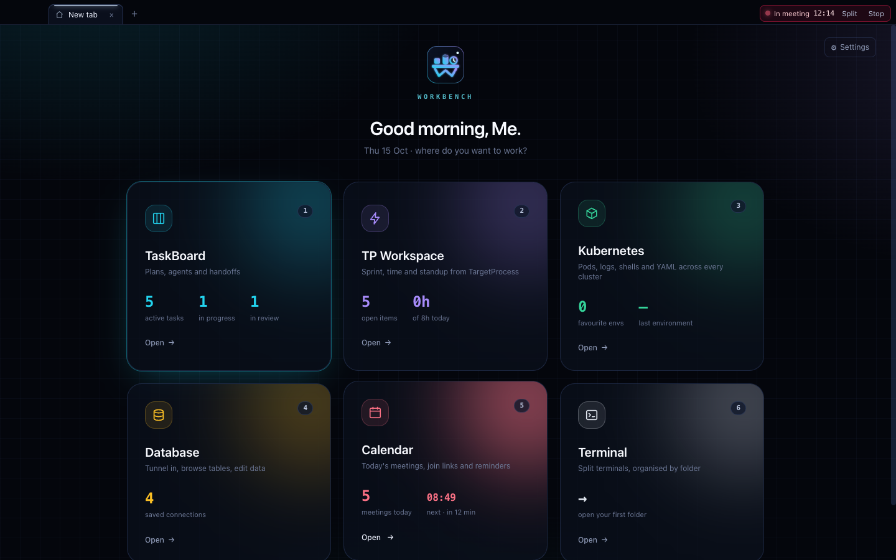
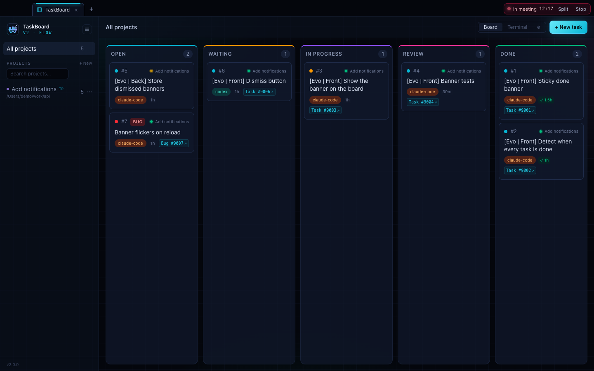
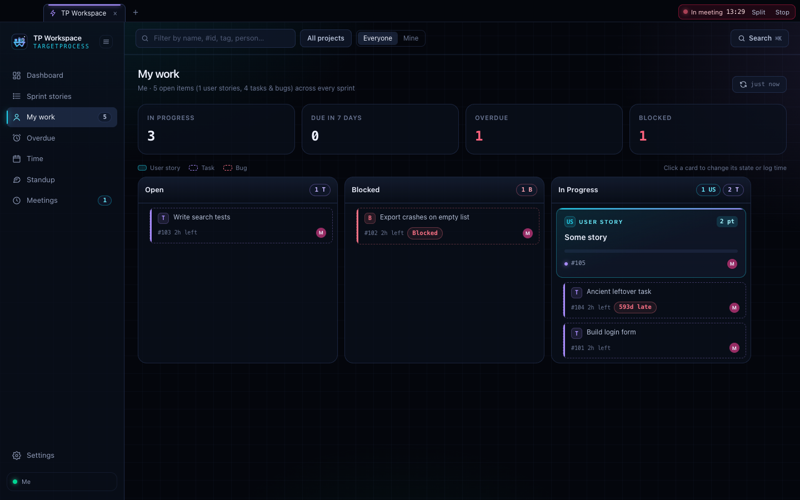
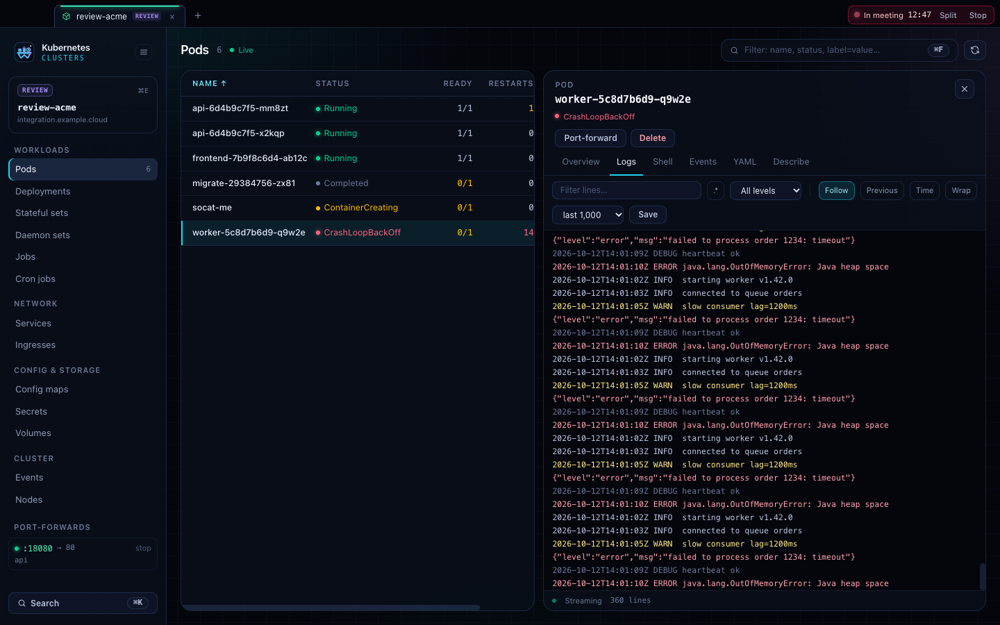
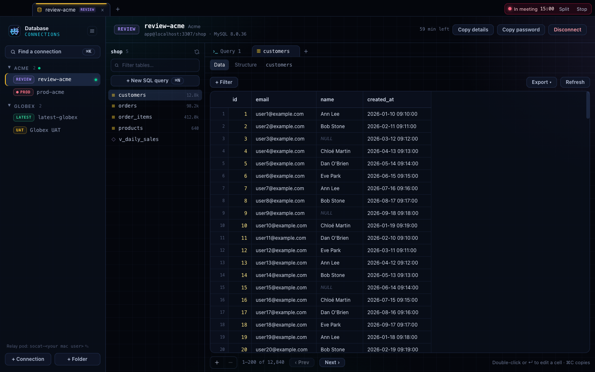
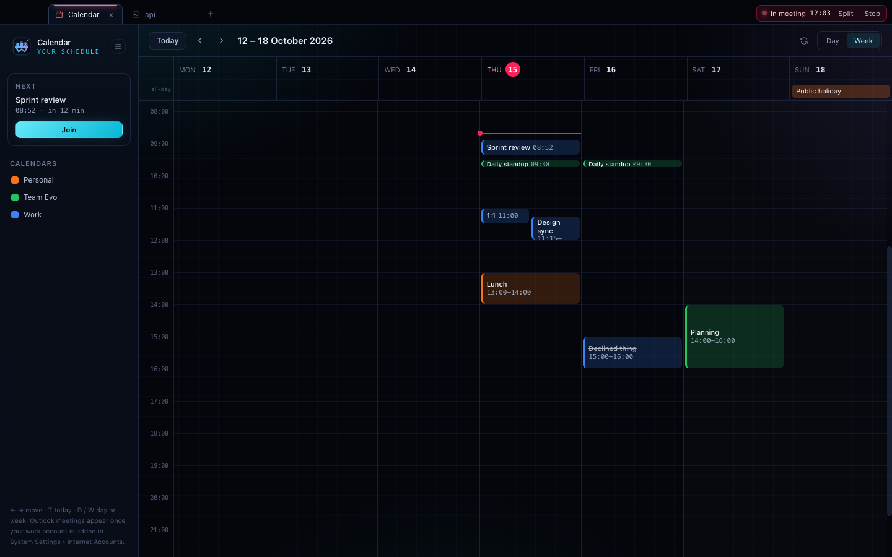
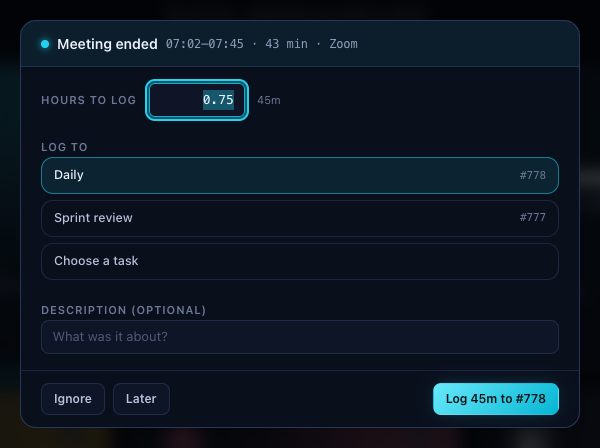
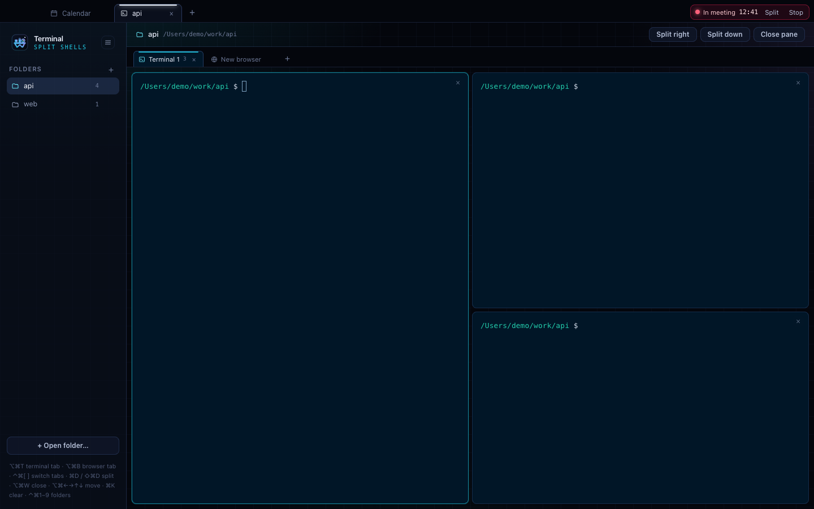
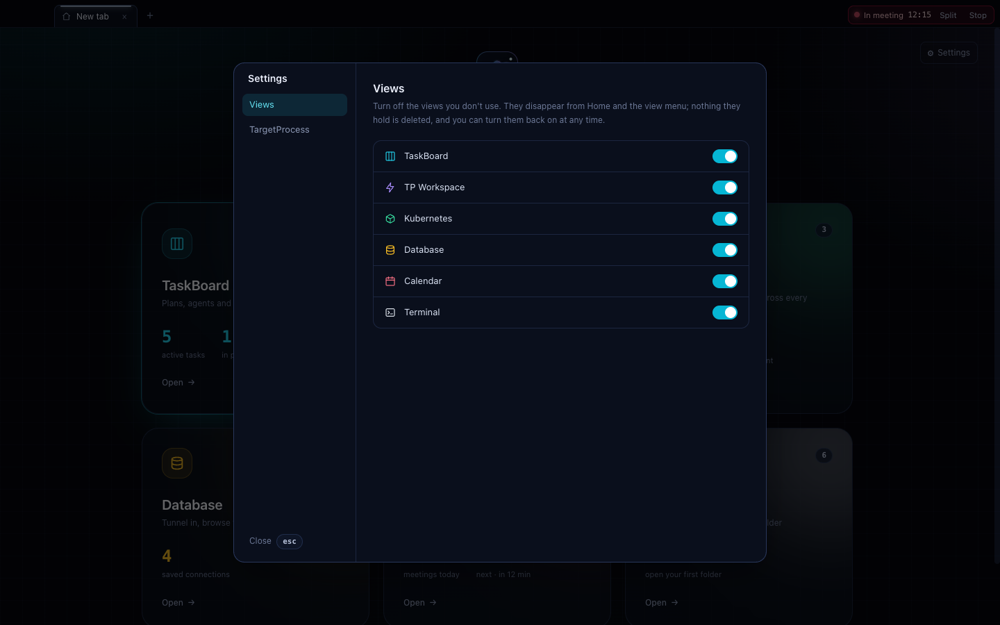

<div align="center">

# Workbench

Your daily developer cockpit: a shared task board for you and your AI agents, plus
TargetProcess, Kubernetes, databases, calendar, meetings and terminals in one macOS app.

macOS desktop app · CLI · MCP server — all backed by the same local data in `~/.workbench`.



</div>

---

## Contents

- [What is Workbench?](#what-is-workbench)
- [Views](#views)
  - [Home and tabs](#home-and-tabs)
  - [TaskBoard](#taskboard)
  - [TP Workspace](#tp-workspace)
  - [Kubernetes](#kubernetes)
  - [Database](#database)
  - [Calendar](#calendar)
  - [Meetings](#meetings)
  - [Terminal](#terminal)
- [Settings](#settings)
- [Install](#install)
- [Connect your AI agent](#connect-your-ai-agent)
- [CLI](#cli)
- [MCP tools reference](#mcp-tools-reference)
- [TargetProcess integration](#targetprocess-integration)
- [Data and configuration](#data-and-configuration)
- [Architecture](#architecture)
- [Development](#development)

## What is Workbench?

Workbench started as **TaskBoard**, a kanban board shared between you and your AI coding
assistants: the AI plans and executes through the MCP server or CLI, you observe and steer
from the app. It has grown into the place where the rest of the working day happens too —
your TargetProcess sprint and timesheet, your Kubernetes environments, database editors,
calendar, meeting time tracking and terminals — each as its own view, opened in tabs.

Every view is optional: turn off the ones you don't use in [Settings](#settings).

> The CLI and MCP server are called `workbench`. The old `taskboard` name still works as an
> alias, and an existing `~/.taskboard` folder is moved to `~/.workbench` automatically
> (a link is left at the old path).

## Views

### Home and tabs

Home opens on launch and in every new tab. Each card shows a live summary of its view and
opens it on click.

- Number keys `1`–`9` open the Nth visible view; `↵` reopens the last one.
- Tabs work like a browser: `⌘T` new tab, `⌘W` close, `⌘1`–`⌘9` pick a tab,
  `⌃Tab` / `⌃⇧Tab` (or `⌘⇧]` / `⌘⇧[`) cycle. Tabs can be dragged to reorder and are
  restored on relaunch.
- The menu next to the logo in every view switches what the current tab shows;
  `⌘`-click opens the view in a new tab.
- **⚙ Settings** (top right) holds the app-wide [settings](#settings).

### TaskBoard



The shared board for you and your AI agents.

- **Kanban board** — `open`, `waiting`, `in_progress`, `review` and `done` columns.
- **Request-based projects** — several projects per folder, each with its own brief, plan and tasks.
- **Context banner** — the AI's original request, approved plan, session id and handoff state.
- **TargetProcess badges** — each synced task links to its TargetProcess Task or Bug, with its sync state.
- **Menubar popover** — compact list with filters, search, quick-add and inline edit.
- **Embedded terminal** — a shell scoped to the selected project's folder.
- **Live sync** — the app, CLI and MCP server react to each other's changes instantly.

### TP Workspace



A read-mostly view of your TargetProcess sprint work.

| Page | What it shows | Shortcut |
|------|---------------|----------|
| Dashboard | The sprint as a board by state, KPIs and a burndown | `⌃⌘1` |
| Sprint stories | Every story with progress and spent / remaining hours | `⌃⌘2` |
| My work | Everything assigned to you, with one-click time logging | `⌃⌘3` |
| Overdue | Unfinished items past their end date or left in an ended sprint | `⌃⌘4` |
| Time | Month / week calendar of logged hours; days under target are flagged | `⌃⌘5` |
| Standup | Yesterday / Today / Blockers generated from your time and work | `⌃⌘6` |
| Meetings | Tracked calls waiting to be logged, and meeting settings | `⌃⌘7` |

Open any item to change its state, log time or jump to it in TargetProcess. Filters
(project, sprint, mine, text) persist. `⌘K` searches items and commands, `⌘R` refreshes,
`⌘,` opens the workspace settings (default projects, colours, daily target, working days,
refresh interval, theme).

Data is fetched live and cached, so pages open instantly and refresh in the background.

### Kubernetes



Pods, logs, shells and YAML across every cluster in your kubeconfig.

- **Environment search** — every namespace on every context is an environment. Type
  `review acme` or `prod-acme`; favourites and recents are pinned. Nothing is loaded until
  you pick one. Clusters that refuse namespace listing still open by typing the namespace.
- **Resources** — Pods, Deployments, StatefulSets, DaemonSets, Jobs, CronJobs, Services,
  Ingresses, ConfigMaps, Secrets, Volumes, Events and Nodes, as live lists with CPU and memory.
- **Logs** — follow, container picker, previous run, timestamps, tail size, text or regex
  filter, level filter, wrap and download.
- **Shell** — an interactive shell into any pod.
- **Port-forward** — for pods and services; running forwards are listed in the sidebar.
- **YAML** — edit, review the diff, server-side dry run, then apply. Find (`⌘F`) and
  find & replace (`⌥⌘F`) in the editor.
- **Actions** — scale, rollout restart and delete.
- **Safety** — every change goes through a confirmation showing the cluster, namespace and
  object. Production targets get a red dialog with focus on Cancel.

Shortcuts: `⌘K` palette · `⌘E` switch environment · `⌘F` filter · `⌘R` reload ·
`⌃⌘1`–`9` resource kind · `Esc` deselect.

### Database



A MySQL editor that opens its own tunnel into the cluster.

- **Client folders** — group connections per client; folders collapse in the sidebar.
  Each connection has an environment (latest, review, uat, preprod, prod), client, local
  port and cluster domain.
- **Shared cluster** — for clients whose database runs on a shared cluster, turn on
  *Shared cluster* and set its context.
- **Tunnel** — on connect, Workbench reads the database credentials from the cluster
  secret, starts a small relay pod, port-forwards to it and connects. Disconnecting (or
  quitting the app) stops the forward and removes the pod; the relay expires on its own
  after an hour. Credentials are never saved, and the password never reaches the UI —
  use *Copy password* when you need it in another client.
- **Tables** — schema browser, paged rows, sorting and filters (equals, contains, not
  contains, starts with, ends with…).
- **Editing** — edit cells, add and delete rows. Changes are staged, the SQL is shown for
  review, and everything runs in one transaction after you confirm. Production is red.
- **SQL tabs** — schema-aware completion, `⌘↵` runs the selection or everything, results
  per statement, cancel, per-connection history. Statements that change data ask first.
- **Export** — save as CSV or JSON, or copy as CSV.

Shortcuts: `⌘K` / `⌘E` find a connection · `⌘N` new SQL tab · `⌘↵` run.

### Calendar



Your Mac calendars (iCloud, Google, Exchange — whatever is added in System Settings →
Internet Accounts), read-only.

- Day and week views, per-calendar toggles, and an event panel with attendees and notes.
- **Next meeting** card with a **Join** button; Teams, Zoom and other meeting links are
  found in the event's URL, location or notes.
- **Reminders** — a notification a few minutes before each meeting (5 by default,
  configurable, 0 turns it off).

Shortcuts: `←` / `→` move · `T` today · `D` day · `W` week · `⌘R` refresh.

### Meetings



Automatic meeting time tracking for TargetProcess.

- **Detection** — Workbench notices when an app is using your microphone (a call has
  started) and when it stops. Nothing is recorded and no microphone permission is needed.
- **During a call** — a live timer in the tab bar and the menu bar, with *Split* and *Stop*.
- **After a call** — a popup asks how many hours to log and where: your daily meeting
  task, a saved shortcut or any task. Rounding is configurable (default: at least 30 min,
  rounded up to 15).
- **Recurring entries** — e.g. the daily standup, logged automatically once per working day
  without duplicating time you already logged by hand.
- **Days off** — weekends, personal days and public holidays are skipped.
- **Import** — settings from an existing TimeAgent install are picked up on first run
  (never its token).
- The menu bar shows hours logged today and how many meetings are still to log.

### Terminal



Split terminals organised by folder, with built-in browser tabs for local dev servers.

- **Folders** — open project folders in the sidebar; each keeps its own tabs.
- **Tabs** — a tab is either terminals or a browser. Split a tab right or down; every pane
  of a split has a close button.
- **Browser tabs** — open `localhost:3000`, any URL, or pick a common dev port.
- Shells start with your login environment (so `kubectl`, `aws`, `nvm`… work as in
  Terminal.app). The layout is restored on relaunch; shells restart in place.

| Action | Shortcut |
|--------|----------|
| Open folder | `⌘O` |
| Pick folder 1–9 | `⌃⌘1`–`9` |
| New terminal tab / browser tab | `⌥⌘T` / `⌥⌘B` |
| Pick tab 1–9 | `⌥⌘1`–`9` |
| Previous / next tab | `⌃⌘[` / `⌃⌘]` |
| Split right / down | `⌘D` / `⇧⌘D` |
| Close pane | `⌥⌘W` |
| Move focus | `⌥⌘` + arrows |
| Clear terminal | `⌘K` |

## Settings



Open **⚙ Settings** from the top right of Home.

- **Views** — turn off any view you don't use (TaskBoard, TP Workspace, Kubernetes,
  Database, Calendar, Terminal). Hidden views disappear from Home and the view menu, the Home
  number keys renumber, and open tabs of a hidden view go back to Home. Nothing they hold is
  deleted. At least one view always stays on.
- **TargetProcess** — instance URL, access token, state mapping and the sync queue (see
  [TargetProcess integration](#targetprocess-integration)). Also reachable from the ⚙ in
  TaskBoard.

## Install

### Requirements

| For | You need |
|-----|----------|
| The app | macOS on Apple Silicon |
| Kubernetes and Database views | `kubectl` on your `PATH` with kubeconfig contexts. The Database view also needs permission to read the database secret and create a pod in the namespace |
| Calendar and reminders | Calendar access (macOS asks the first time) |
| TP Workspace, meeting logging, task sync | A TargetProcess URL and personal access token |
| Building from source | Rust ([rustup.rs](https://rustup.rs)), Node.js ≥ 18 and pnpm |

### From a DMG

1. Open `Workbench_<version>_aarch64.dmg` and drag **Workbench** into Applications.
2. The app is signed ad hoc, not with an Apple Developer ID, so macOS blocks the first
   launch. Either run

   ```bash
   xattr -dr com.apple.quarantine /Applications/Workbench.app
   ```

   or try to open it once, then click **Open Anyway** in System Settings → Privacy & Security.
3. Install the CLI if you want the MCP server (see [below](#connect-your-ai-agent)).

### From source

```bash
git clone https://github.com/Alae-Ouardi/Agents-TaskBoard.git
cd Agents-TaskBoard
pnpm install

# App + DMG (signed ad hoc)
pnpm tauri build --bundles app,dmg
# → target/release/bundle/macos/Workbench.app
# → target/release/bundle/dmg/Workbench_<version>_aarch64.dmg

ditto target/release/bundle/macos/Workbench.app /Applications/Workbench.app

# CLI + MCP server, registered with Claude Code, Codex and OpenCode
scripts/setup.sh
```

## Connect your AI agent

`scripts/setup.sh` builds the CLI, installs `workbench` (and the `taskboard` alias) into
`/usr/local/bin`, and registers the MCP server with Claude Code, Codex and OpenCode. To do it
by hand:

**Claude Code**

```bash
claude mcp add --scope user workbench -- workbench mcp
```

**Codex** (`~/.codex/config.toml`)

```toml
[mcp_servers.workbench]
command = "workbench"
args = ["mcp"]
```

**OpenCode** (`opencode.json`)

```json
{
  "mcp": {
    "workbench": {
      "type": "local",
      "command": ["workbench", "mcp"]
    }
  }
}
```

Then give your agent the rules in [docs/AGENT_RULES.md](docs/AGENT_RULES.md), or this short version:

> You have a Workbench MCP server. Use it for every project:
>
> 1. **`get_briefing`** first — it returns the original request, the approved plan, where the last AI stopped and the task to resume.
> 2. **`create_project`** — one project per request, even for the same folder.
> 3. **`set_project_context`** — right after the plan is approved: the verbatim request and a short plan summary.
> 4. **`create_tasks`** — small, verifiable tasks, chained with `depends_on`, each with `estimate_points` (1 = 1 hour of human work).
> 5. **`update_task_status`** — `in_progress` before starting a task, `done` right after finishing it.
> 6. **`save_handoff`** — after each phase and before stopping, with your session id.

## CLI

```bash
# Create a request-project
workbench create-project --path /path/to/repo --name "Add notifications" \
  --description "Add sticky notification when all tasks are done"

# Add a task, move it
workbench add --project "Add notifications" "Write integration tests" --priority high
workbench move 42 in_progress

# Briefing and handoff
workbench briefing --project "Add notifications"
workbench handoff --project "Add notifications" \
  --session "abc-123" --task 42 --note "Backend done. Next: integration tests."

# TargetProcess
workbench tp status      # connection + queue summary
workbench tp link 12345  # link the current project to user story #12345
workbench tp sync        # push everything queued now
workbench tp queue       # list queued operations and their errors
workbench tp retry       # make every failed operation due again
```

## MCP tools reference

| Tool | Parameters | Description |
|------|-----------|-------------|
| `create_project` | `path`, `name`, `description`, `tp_user_story?` | Create a request-project for a folder, optionally linked to a TargetProcess user story |
| `list_projects` | — | All projects with per-status task counts |
| `create_tasks` | `project_id`, `tasks[]`, `actor` | Create tasks with dependencies, priorities, assignees and `estimate_points` |
| `list_tasks` | `project?`, `status?`, `assignee?` | List tasks, optionally filtered |
| `get_task` | `id` | Description, dependencies, comments and activity |
| `update_task_status` | `id`, `status`, `actor` | Move a task (finishing one promotes the tasks waiting on it) |
| `update_task` | `id`, `title?`, `description?`, `assignee?`, `priority?`, `estimate_points?` | Edit task fields |
| `set_task_dependencies` | `id`, `depends_on[]`, `actor` | Replace a task's dependencies |
| `add_task_comment` | `id`, `author`, `body` | Add a note or comment |
| `delete_task` | `id` | Delete a task |
| `get_briefing` | `project_id` | Context, handoff state, task to resume and the task list |
| `set_project_context` | `project_id`, `original_request`, `plan_summary` | Store the north-star context |
| `save_handoff` | `project_id`, `actor`, `session_id`, `note`, `current_task_id` | Record where you stopped |
| `delete_project` | `project_id` | Delete a project and its tasks |
| `link_project_user_story` | `project_id`, `user_story`, `backfill?` | Link a project to a TargetProcess user story (id or URL) |
| `unlink_project_user_story` | `project_id` | Stop syncing a project |
| `tp_repush_project` | `project_id` | Queue every task of a linked project again |
| `tp_sync_status` | — | Whether TargetProcess is configured, and what is queued or failed |

## TargetProcess integration

Link a project to a TargetProcess user story, and from then on:

- its tasks — created by you or an agent — appear as TargetProcess Tasks (or Bugs) under
  that story, on the story's team and sprint;
- moving a task on the board moves the TargetProcess entity through the matching states;
- finishing a task logs its `estimate_points` as time spent (**1 point = 1 hour**);
- every synced project and task shows a clickable TargetProcess id.

### Setup

1. In TargetProcess, open **My Profile → Access Tokens** and copy a personal access token.
2. In Workbench, open **⚙ Settings → TargetProcess** (from Home, or the ⚙ in TaskBoard).
   Enter your instance URL (`https://yourco.tpondemand.com`) and the token, then
   **Test connection** — it should show your name.
3. Check that the **in progress → review → done** state names match your workflow. Clear a
   field to stop pushing that transition.
4. Turn on **Push changes to TargetProcess**.
5. Link a project from the **⋯** menu next to it in the TaskBoard sidebar (or the **⋮** in the
   menubar popover) and search for its user story. Existing tasks can be mirrored too.

The same URL and token power the TP Workspace and meeting time logging.

### How syncing behaves

Sync is **local-first**: the board never waits on the network. Changes are queued by
whichever process made them (app, MCP server or CLI) and pushed by the app every ~15 s, or
immediately with `workbench tp sync`. Failures are retried with backoff and, after 8
attempts, parked for a manual retry. Task badges show amber (queued), green (in sync) or red
(failed, with the reason); the **Sync queue** in Settings lists everything outstanding with
Retry and Dismiss. Time is logged once per task — re-finishing a task never double-logs it.

## Data and configuration

Everything lives in `~/.workbench` on your Mac.

| File | Holds |
|------|-------|
| `taskboard.db` | The board: projects, tasks, comments, activity (SQLite, WAL mode, shared by app, CLI and MCP server) |
| `config.json` | TargetProcess settings, without the token |
| `workspace.json` | TP Workspace preferences |
| `tp-cache.db` | TargetProcess cache, safe to delete |
| `connections.json` | Database folders and connections (no credentials) |
| `meetings.json` | Meeting settings and calls waiting to be logged |

View visibility, tab layout, terminal folders and other small UI choices are kept in the
app's local storage.

**Secrets.** The TargetProcess token is stored in the **macOS Keychain** (service
`net.omnevo.taskboard`, account `tp-token`), never in a file; without a usable keychain it
falls back to `~/.workbench/tp-token.secret` with `0600` permissions. Database passwords are
read from the cluster on every connect and never stored.

**Environment variables**

| Variable | Default | Description |
|----------|---------|-------------|
| `TASKBOARD_DB` | `~/.workbench/taskboard.db` | Board database |
| `TASKBOARD_CONFIG` | `~/.workbench/config.json` | TargetProcess settings file |
| `TASKBOARD_TP_CACHE` | `~/.workbench/tp-cache.db` | TargetProcess cache |
| `TASKBOARD_ACTOR` | `cli` | Actor name the CLI records in the activity log |

## Architecture

```
├── crates/
│   ├── taskboard-core/   # Rust: SQLite board, TargetProcess client + sync, paths, config
│   └── taskboard-cli/    # `workbench` / `taskboard`: CLI subcommands + MCP server (stdio)
├── src-tauri/src/        # Tauri 2 app (Rust)
│   ├── k8s/              # kubectl wrapper: lists, watches, logs, exec, port-forward, actions
│   ├── db/               # DB connections, tunnel, sessions, queries, staged changes
│   ├── calendar/         # EventKit calendars, join-link detection, reminders
│   ├── meetings/         # Mic detection, call tracker, menubar timer, holidays, settings
│   ├── browser.rs        # Browser panes for the Terminal view
│   ├── pty.rs            # Terminal sessions
│   └── tray.rs, menu.rs  # Menubar and app menu
└── src/                  # React + TypeScript frontend
    ├── shell/            # Home, tabs, view switcher, global settings
    ├── components/       # TaskBoard: board, sidebar, drawers, tray popover
    ├── tp-workspace/     # TP Workspace pages
    ├── k8s/ db/ calendar/ meetings/ terminal/   # One folder per view
    └── shared/           # Confirm dialog, editor, data grid, palette, terminal view
```

## Development

```bash
pnpm install
pnpm tauri dev                    # run with hot reload
pnpm exec vitest run              # frontend tests
cargo test --workspace            # Rust tests
pnpm exec tsc --noEmit            # type-check
pnpm tauri build --bundles app,dmg
cargo build -p taskboard-cli --release
```

| Layer | Technology |
|-------|-----------|
| Core | Rust, rusqlite (SQLite), ureq |
| App | Tauri 2, React 19, TypeScript, Tailwind CSS, Vite, CodeMirror 6, xterm.js |
| CLI and MCP | Rust, clap, serde_json (stdio JSON-RPC) |
| Kubernetes | `kubectl` |
| Database | `mysql` crate over a `kubectl port-forward` tunnel |

## License

MIT
