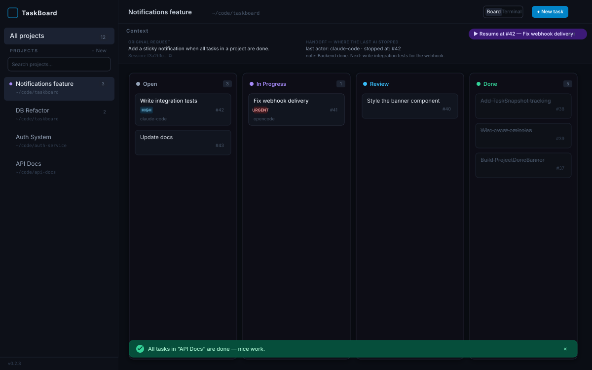
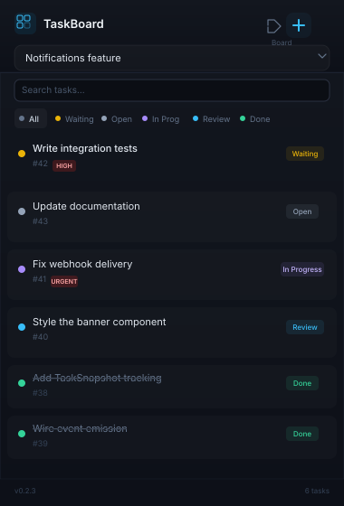

<div align="center">

# TaskBoard

A shared kanban board for humans and AI coding agents.

macOS desktop app · CLI · MCP server — all backed by the same local SQLite database.





</div>

---

## What is TaskBoard?

TaskBoard bridges the gap between **you** and your **AI coding assistants**. It's a kanban board where both humans and AI agents create tasks, track progress, and hand off work — all in one place. The AI plans and executes through the MCP or CLI; you observe and steer through the desktop app.

**Key idea:** every request gets its own project with its own context, even if multiple projects point to the same folder. This means you can have "add notifications" and "refactor the database" as separate projects for the same repo, each with isolated tasks and context.

## Features

### Desktop App

- **Kanban board** — columns for `open`, `waiting`, `in_progress`, `review`, and `done`
- **Request-based projects** — multiple projects per folder, each with its own context and task list
- **Context banner** — shows the AI's original brief, approved plan, session ID, and handoff state
- **Project search** — filter projects by name in the sidebar
- **Menubar popover** — compact view with filter tabs (All · Waiting · Open · In Progress · Review · Done), task search, quick-add, inline edit, delete, and a footer showing done/total, summed effort and sync status
- **Sticky "all done" banner** — appears when every task in a project is complete
- **Embedded terminal** — shell panel scoped to the selected project's directory
- **TargetProcess sync** — link a project to a user story and its tasks are mirrored there ([details](#targetprocess-integration))
- **Live sync** — all windows and tools react to changes instantly

### TP Workspace (new in 2.0)

The home screen now opens either **TaskBoard** (everything above) or the **TP Workspace**, a read-mostly view of your TargetProcess sprint work:

- **Dashboard** — the sprint as a board by workflow state, progress / delivered / days-left / attention KPIs, and a burndown (rebuilt from item finish dates, since TargetProcess keeps no remaining-effort history)
- **Sprint stories** — every story in the sprint with progress and spent / remaining hours, expandable to its tasks and bugs
- **My work** — everything assigned to you across sprints, grouped by state, with one-click `+0.5h / +1h / +2h` time logging
- **Overdue** — unfinished items past their planned end or left in an ended sprint (last 180 days), most late first
- **Time** — month / week calendar of your logged hours; click a day for the breakdown. Working days under your daily target are flagged and listed so the timesheet is easy to fill
- **Standup** — Yesterday / Today / Blockers generated from your logged time and assigned work, ready to copy
- **Item drawer** — open any item to move it to another state, log time against it, or jump to it in TargetProcess
- **Filters and search** — project (ILS, Evo…), sprint, "mine" and text filters that persist; `⌘K` searches items and commands

Shortcuts: `⌘0` home · `⌘1` TaskBoard · `⌘2` TP Workspace · `⌘K` search · `⌘R` refresh · `⌃⌘1–6` workspace views · `⌘,` settings.

Data is fetched live and cached in `~/.taskboard/tp-cache.db`, so views open instantly and refresh in the background. Workspace preferences (default projects, colours, daily target, working days, refresh interval, theme) live in `~/.taskboard/workspace.json`. The TargetProcess URL and token are the same ones the sync uses.

### CLI

- Create projects, tasks, and bugs
- Set context and handoff state
- List, move, update, and search tasks
- Works in any terminal — no app required

### MCP Server

- Full tool suite for AI agents: plan, create, track, hand off
- Works with Claude Code, Codex, OpenCode, and any MCP-compatible client
- AI agents see the same board you do

## Quick Start

### Prerequisites

- **macOS** (Tauri 2 with menubar support)
- **Rust** — [rustup.rs](https://rustup.rs)
- **Node.js ≥ 18** + **pnpm**

### Build & Install

```bash
git clone https://github.com/YOUR_USERNAME/taskboard.git
cd taskboard

# Install dependencies
pnpm install

# Build the desktop app + CLI
pnpm tauri build
cargo build -p taskboard-cli --release

# Install the CLI
cp target/release/taskboard /usr/local/bin/taskboard

# Install the app
cp -R target/release/bundle/macos/TaskBoard.app /Applications/
```

### Connect Your AI Agent

Add Workbench as an MCP server in your AI tool's config (or run `scripts/setup.sh`). The
command is `workbench`; `taskboard` still works as an alias.

**Claude Code** (`~/.claude/mcp_servers.json`):
```json
{
  "mcpServers": {
    "workbench": {
      "command": "workbench",
      "args": ["mcp"]
    }
  }
}
```

**OpenCode** (`opencode.json`):
```json
{
  "mcp": {
    "workbench": {
      "type": "local",
      "command": ["workbench", "mcp"]
    }
  }
}
```

That's it — your AI agent can now plan tasks, track progress, and hand off work on Workbench.

## How to Use

### From the App

1. Click **+ New** in the sidebar to create a project — pick a folder, give it a name, and describe what you want built (the AI reads this as its brief).
2. Create tasks manually with **+ New task**, or let an AI agent plan tasks for you via the CLI/MCP.
3. The **Context banner** shows the original request, approved plan, and where the last AI session stopped.
4. Use the **menubar icon** for a quick glance at tasks without opening the full window.

### From the CLI

```bash
# Create a new request-project
taskboard create-project --path /path/to/repo --name "Add notifications" \
  --description "Add sticky notification when all tasks are done"

# Add a task to it
taskboard add --project "Add notifications" "Write integration tests" --priority high

# Move a task
taskboard move 42 in_progress

# See the briefing (context + handoff + resume task)
taskboard briefing --project "Add notifications"

# Record a handoff
taskboard handoff --project "Add notifications" \
  --session "abc-123" --task 42 \
  --note "Backend done. Next: write integration tests."
```

### From Your AI Agent

Give your AI agent this prompt:

> You have a TaskBoard MCP server with the following tools. Use them for every project:
>
> 1. **`get_briefing`** — call this FIRST when you start work on a project. It returns the original request, the approved plan, where the last AI stopped, and the task you should resume on.
> 2. **`create_project`** — create a new request-project for a folder. Each request should be its own project, even if it points to the same folder as an existing project.
> 3. **`set_project_context`** — call this right after the user approves your plan. Store the user's verbatim original request and a short summary of the approved plan.
> 4. **`create_tasks`** — break the plan into small, verifiable tasks and create them all at once before starting execution. Use `depends_on` with negative indexes to chain sequential tasks.
> 5. **`update_task_status`** — move a task to `in_progress` before you start working on it, and `done` when finished. Marking a task done auto-promotes waiting tasks whose dependencies are satisfied.
> 6. **`save_handoff`** — call this after each phase and before you stop. Record the task you're on, a short note on what's done and what's next, and your session ID so the user can resume this exact session later.
> 7. **`list_projects`** — list all projects if you need to find a project ID.
>
> **Lifecycle for every task:** `in_progress` → do the work → `done`. Never skip marking tasks. The board stays accurate for the next agent.

## MCP Tools Reference

| Tool | Parameters | Description |
|------|-----------|-------------|
| `create_project` | `path`, `name`, `description`, `tp_user_story?` | Create a new request-project for a folder, optionally linked to a TargetProcess user story |
| `list_projects` | — | List all projects with per-status task counts |
| `create_tasks` | `project_id`, `tasks[]`, `actor` | Create one or more tasks with dependencies, priorities, assignees, and `estimate_points` |
| `list_tasks` | `project?`, `status?`, `assignee?` | List tasks, optionally filtered |
| `get_task` | `id` | Full task detail: description, dependencies, comments, activity |
| `update_task_status` | `id`, `status`, `actor` | Move a task (auto-promotes waiting tasks when done) |
| `update_task` | `id`, `title?`, `description?`, `assignee?`, `priority?`, `estimate_points?` | Edit task fields |
| `set_task_dependencies` | `id`, `depends_on[]`, `actor` | Replace a task's dependency set |
| `add_task_comment` | `id`, `author`, `body` | Add a handoff note or comment |
| `delete_task` | `id` | Delete a task permanently |
| `get_briefing` | `project_id` | Returns context, handoff state, resume task, and full task list |
| `set_project_context` | `project_id`, `original_request`, `plan_summary` | Store the north-star context |
| `save_handoff` | `project_id`, `actor`, `session_id`, `note`, `current_task_id` | Record where you stopped |
| `delete_project` | `project_id` | Delete a project and all its tasks |
| `link_project_user_story` | `project_id`, `user_story`, `backfill?` | Link a project to a TargetProcess user story (id or entity URL) |
| `unlink_project_user_story` | `project_id` | Stop syncing a project; TargetProcess entities are left alone |
| `tp_sync_status` | — | Whether TargetProcess is configured, and what is queued or failed |

## TargetProcess integration

Link a TaskBoard project to a TargetProcess user story, and from then on:

- tasks created in that project — by you or by an agent — appear as TargetProcess
  Tasks (or Bugs) under that story;
- marking a task `done` moves the TargetProcess entity to your done state;
- the task's `estimate_points` is logged there as time spent, where **1 point = 1 hour**
  and `0.5` = 30 minutes;
- every synced project and task shows a clickable TargetProcess id.

### Setup

1. In TargetProcess, go to **My Profile → Access Tokens** and copy a personal access token.
2. In TaskBoard, open the **⚙** panel in the top bar. Enter your instance URL
   (`https://yourco.tpondemand.com`) and the token, then hit **Test connection** — it
   should show your name.
3. Check the **open → in progress → review → done** state names match your workflow (they
   default to `In Progress` / `In Review` / `Done`). Clear a field to stop pushing that
   transition — `open` and `waiting` have no TargetProcess equivalent, since a new entity
   already starts in its initial state.
4. Turn on **Push changes to TargetProcess** — a task now moves through TargetProcess the same
   way it moves through the board, automatically.
5. Link a project: use the **⋯** menu next to it in the sidebar (or the **⋮** button in the
   menubar popover) and search for its user story. If the project already has tasks, you'll
   be offered to mirror them.

The token is stored in your **macOS Keychain** (service `net.omnevo.taskboard`), never in a
file. Non-secret settings live in `~/.taskboard/config.json`.

### How syncing behaves

Sync is **local-first**: the board never waits on the network. Changes are queued in the
database by whichever process made them (app, MCP server, or CLI), and pushed by a
background worker every ~15s — or immediately with `taskboard tp sync`. Failures are
retried with exponential backoff and, after 8 attempts, parked for a manual retry. Each
task carries a badge: amber (queued), green (in sync), red (failed, with the reason). The
**Sync queue** panel in Settings lists everything outstanding, with per-item Retry and Dismiss.

Time is logged once per task, guarded by what has actually been recorded — reopening and
re-finishing a task replays the state change but never double-logs its time.

```bash
taskboard tp status            # connection + queue summary
taskboard tp link 12345        # link the current project to user story #12345
taskboard tp sync              # push everything queued now
taskboard tp queue             # list queued operations and their errors
taskboard tp retry             # make every failed operation due again
```

## Architecture

```
taskboard/
├── crates/
│   ├── taskboard-core/        # Rust lib: SQLite schema, all DB logic
│   └── taskboard-cli/         # Binary: CLI subcommands + MCP server (stdio)
├── src-tauri/                 # Tauri 2 app shell (Rust)
├── src/                       # React + TypeScript frontend (Vite)
│   └── components/
│       ├── Board.tsx           # Kanban columns
│       ├── ContextBanner.tsx   # Project context + handoff display
│       ├── TrayPopover.tsx     # Menubar popover window
│       ├── Sidebar.tsx         # Project list + search
│       ├── TaskDrawer.tsx      # Task detail panel
│       ├── NewProjectModal.tsx # Project creation
│       └── Terminal.tsx        # Embedded terminal
└── ~/.taskboard/
    └── taskboard.db            # Shared SQLite DB (WAL mode)
```

The desktop app, CLI, and MCP server all read and write to the same SQLite database at `~/.taskboard/taskboard.db`. WAL mode enables safe concurrent access from multiple processes.

## Tech Stack

| Layer | Technology |
|-------|-----------|
| Core library | Rust, rusqlite (SQLite), thiserror |
| Desktop app | Tauri 2, React 19, TypeScript, Tailwind CSS, Vite |
| CLI | Rust, clap |
| MCP server | Rust, serde_json (stdio JSON-RPC) |
| Database | SQLite (WAL mode, foreign key cascades) |

## Development

```bash
# Install dependencies
pnpm install

# Run in development mode (hot reload)
pnpm tauri dev

# Run tests
cargo test --workspace

# Type-check frontend
pnpm tsc --noEmit

# Production build
pnpm tauri build
cargo build -p taskboard-cli --release
```

## Configuration

| Variable | Default | Description |
|----------|---------|-------------|
| `TASKBOARD_DB` | `~/.taskboard/taskboard.db` | Path to the SQLite database |
| `TASKBOARD_CONFIG` | `~/.taskboard/config.json` | Path to the settings file (TargetProcess URL, state mapping) |
| `TASKBOARD_ACTOR` | `cli` | Default actor name for CLI actions |

The TargetProcess access token is **not** an environment variable or a config field — it
lives in the macOS Keychain under service `net.omnevo.taskboard`, account `tp-token`, and is
set from the Settings panel. On systems without a usable keychain it falls back to
`~/.taskboard/tp-token.secret` with `0600` permissions.

## License

MIT